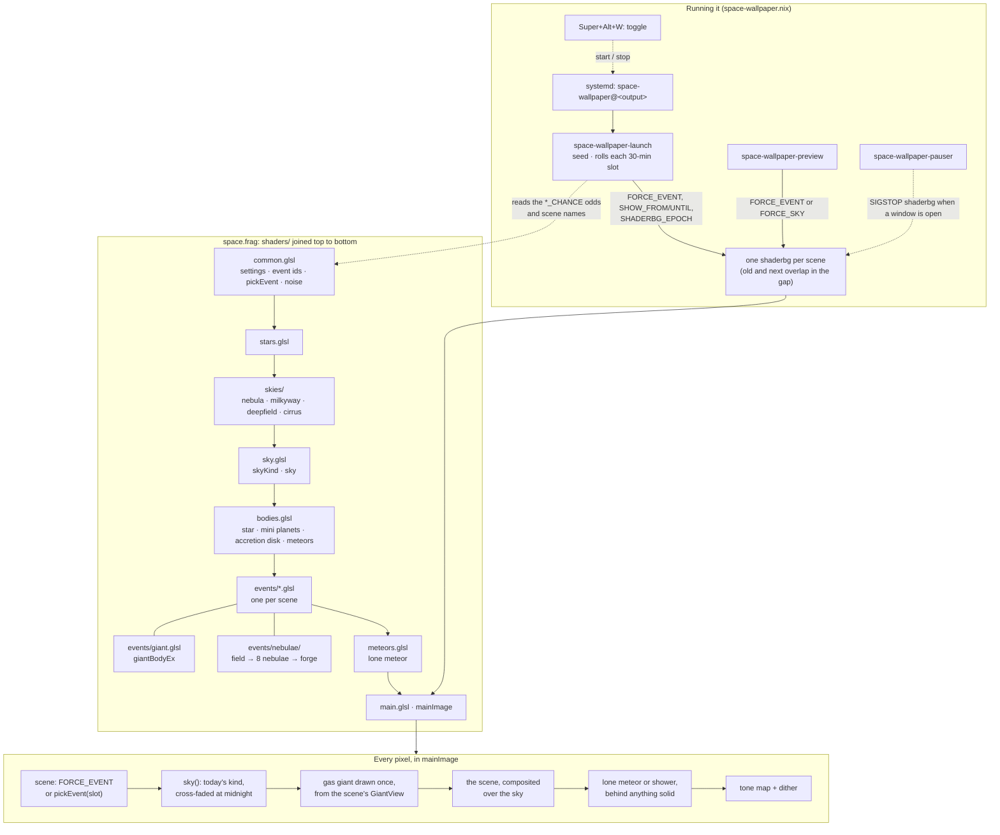

# Space wallpaper

An animated space wallpaper for Hyprland. A GLSL shader is drawn by
[shaderbg](https://github.com/Mr-Pine/shaderbg) on every monitor. Each monitor shows a slowly
drifting starfield and nebula, and every 30 minutes rolls a new scene: a black hole, a gas giant, a
moonscape, an orbital sunrise, and so on.

## Using it

| | |
|---|---|
| Toggle on/off | `Super+Alt+W` (`space-wallpaper-toggle`) |
| Preview a scene | `space-wallpaper-preview <scene> [output] [seconds] [seed]` |
| Logs (seed, scenes rolled) | `journalctl --user -u 'space-wallpaper@*'` |
| Restart | `systemctl --user restart 'space-wallpaper@*'` |

**Preview.** `space-wallpaper-preview giant` shows the gas giant on DP-2 for 20 s. Run it with no
arguments to list the scene names. A sky name (`nebula`, `milkyway`, `deepfield`, `cirrus`,
`void`) shows that background on its own. It prints the seed it used, so you can pass that seed
back to get the same scene (and sky) again.

**Seeds.** Each launch picks a random seed (0–99999) and logs it. The seed decides which
scenes roll and how each one looks; the sky goes by the date instead (see below). To replay a launch you liked:

```sh
systemctl --user set-environment SPACE_WALLPAPER_SEED=1234
systemctl --user restart 'space-wallpaper@*'
systemctl --user unset-environment SPACE_WALLPAPER_SEED   # back to random next time
```

Each monitor still differs under one seed, because the output name and resolution are mixed in.

**Pausing.** `space-wallpaper-pauser` freezes a monitor's wallpaper (SIGSTOP to its `shaderbg`
processes) whenever a window is open on it, so it uses no GPU while you're working. The launcher
isn't frozen, so scenes still change on time behind your windows.

## How it runs

`space-wallpaper.nix` concatenates the shader parts below into one `space.frag`. A
`space-wallpaper@<output>` systemd user unit then runs `space-wallpaper-launch <output>`, which works
like this:

1. **Seeding.** It picks the seed and writes a copy of the shader with the seed in it.
2. **Scheduling.** The scene list and odds come straight from the shader, read at build time into
   an event table (`eventTable` in `space-wallpaper.nix`): each `*_CHANCE` paired with its `EV_*` in
   `pickEvent`, plus `PLAIN_SKY_SHARE`. A scene's name is its `EV_` name in lower case; the preview
   looks names up in the same table. The launcher rolls each 30-minute slot's scene from the seed.
3. **One shader per scene.** It runs each scene as its own `shaderbg` process, from a copy of the
   shader with `FORCE_EVENT` set. With the event fixed, the GPU driver drops every other scene's
   code, and the shader compiles in about 3–5 s instead of 20+.
4. **The hand-over.** The last `SWAP_GAP` (30) seconds of every slot are plain sky. A moment into
   that gap the launcher starts the next scene's process, waits for it to compile, then stops the old
   one. All of a monitor's processes share one clock (`SHADERBG_EPOCH`, from
   `shaderbg-epoch.patch`), and outside its own slot each process draws just the sky
   (`SHOW_FROM`/`SHOW_UNTIL`). So during the overlap both draw the identical picture, and the swap
   can't be seen.

`shaderbg-hidpi.patch` makes shaderbg render at the monitor's real resolution on scaled outputs. It
renders at 20 fps; everything moves slowly enough that more frames only cost GPU.

## Files

Joined into `space.frag` in this order (GLSL needs everything defined before it's used):

| File | What's in it |
|---|---|
| `common.glsl` | Settings (scene length, fades, odds), event ids, `pickEvent`, noise, hashes, helpers |
| `stars.glsl` | Star layers (`starLayer`, `heatStars`), for the sky and for scenes with their own stars |
| `skies/*.glsl` | One file per background kind: `nebula`, `milkyway`, `deepfield`, `cirrus` |
| `sky.glsl` | `skyKind` (which kind today) and `sky` (gradient, that kind, stars); the void lives here |
| `bodies.glsl` | Shared bodies: stars (`star`), small planets, black-hole accretion disk, meteors (`meteorLight`) |
| `events/*.glsl` | One file per scene (or a pair of related ones, like `galaxy`, `pulsar`, `binary`) |
| `events/giant.glsl` | The gas giant renderer, shared by `giant`, `planet`, `moon` and `ringplane` |
| `events/nebulae/` | The eight full-screen nebulae: `field` (shared gas and dust), one file per nebula, then `forge` (picks one, adds the stars) |
| `meteors.glsl` | The rare lone meteor, over every scene (the shower is `events/shower.glsl`) |
| `main.glsl` | `mainImage`: picks the scene, draws the sky, composites the scene, meteors, tone map |

## How it all ties together



## Background skies

Every day at local midnight the background changes to a new kind and layout, cross-fading over two
minutes. It's picked from the date (each monitor its own), so it stays the same all day, even
across restarts and logins. The launcher gives each scene's shader the date as `SKY_DAY` and the
time of the next local midnight as `SKY_NEXT` (from `date`, so clock-change days switch at
midnight too). The kind
is rolled in `skyKind` in `sky.glsl`, and each kind is drawn by its own file in `skies/`.
Full-screen scenes hide it.

**Meteors.** A lone shooting star crosses rarely: each 3-minute window has a 1 in 10 chance of one
(`METEOR_WINDOW`, `METEOR_ODDS` in `meteors.glsl`), so about one every half hour. It's a quick
streak with no lingering train, hidden behind anything solid and in scenes with no air. Meteor
showers are their own scene (`shower`).

| Preview name | Odds | Sky |
|---|---|---|
| `nebula` | 40% | Colourful nebula clouds, in one of four palettes |
| `milkyway` | 20% | The Milky Way: a band of stars with a warm bulge, dark dust lanes, pink knots |
| `deepfield` | 15% | Hubble Deep Field: tiny distant ellipticals, spirals and red specks |
| `cirrus` | 15% | Faint grey-blue and brown dust wisps over sparse stars |
| `void` | 10% | Deep black and sparse stars |

## Scenes

Odds are relative weights (`*_CHANCE` in `common.glsl`). Together the scenes share the 75% of slots
that aren't plain sky. The cost column is extra GPU busy time over plain sky on a 4K
monitor at 20 fps, for one seed (plain sky with the nebula background is about 5.5%). Scenes that
replace the background can come out below zero.

| Preview name | Id | Weight | Cost | Scene |
|---|---|---|---|---|
| `hole` | 1 | .04 | +1.6% | Gargantua-style black hole, lensing the sky |
| `star` | 2 | .04 | +1.6% | A sun, red giant or blue star with granulation, spots, prominences |
| `system` | 3 | .04 | +2.1% | A star with orbiting planets |
| `comet` | 4 | .04 | +0.6% | A comet crossing the screen: dust and ion tails |
| `field` | 5 | .05 | +5.0% | Ray-marched tumbling asteroids |
| `planet` | 6 | .04 | +0.3% | A planet: gas giant, Earth-like, ocean, desert, ice, lava or barren |
| `spiral` | 7 | .04 | +3.6% | Spiral galaxy |
| `pillars` | 8 | .04 | +5.0% | Pillars of Creation–style dust columns |
| `crab` | 9 | .05 | −1.0% | Crab Nebula–style supernova remnant |
| `ring` | 10 | .04 | −0.8% | Ring nebula (M57) |
| `bipolar` | 11 | .04 | +4.1% | Butterfly/Hourglass nebula |
| `elliptical` | 12 | .04 | +1.1% | Elliptical galaxy |
| `bigcomet` | 13 | .06 | −1.7% | Comet nucleus close-up |
| `binary` | 14 | .03 | +2.0% | Two stars orbiting each other |
| `eaten` | 15 | .02 | +3.7% | A white dwarf stripping gas from a giant |
| `pulsar` | 16 | .04 | +1.8% | Pulsar with sweeping beams |
| `pulsarclose` | 17 | .02 | +4.4% | Neutron star close-up |
| `supernova` | 18 | .02 | +5.8% | A star explodes, leaving a filamentary remnant |
| `surface` | 19 | .04 | +1.4% | Skimming a star's surface |
| `collision` | 20 | .04 | +0.4% | Two galaxies merging |
| `quasar` | 21 | .05 | −2.3% | Quasar with jets |
| `rogue` | 22 | .05 | −2.7% | Dark rogue planet against the stars |
| `horizon` | 23 | .02 | +15.0% | Low orbit over a planet: clouds, oceans, city lights, aurora |
| `cluster` | 24 | .05 | −0.4% | Globular or open star cluster |
| `giant` | 25 | .05 | +1.5% | Gas giant close-up: storms, eddies, rings, a moon |
| `moon` | 26 | .02 | +12.1% | Standing on a moon under a giant; eclipses, an inner moon |
| `ringplane` | 27 | .03 | −0.4% | Hanging over a giant's rings, Cassini-style |
| `cliffs` | 28 | .015 | +10.0% | JWST Cosmic Cliffs: ranges of dust receding into blue haze |
| `orion` | 29 | .02 | +3.7% | Orion: pink-red cloud around a blazing core, teal gas, dust lanes |
| `lagoon` | 30 | .02 | +3.4% | Lagoon/Trifid: magenta and orange, snaking dust, a blue lobe |
| `rosette` | 31 | .02 | +3.4% | Rosette: a ring of red gas around a blown-clear cavity |
| `horsehead` | 32 | .02 | +6.2% | Horsehead: a dark pillar against a glowing red curtain |
| `tarantula` | 33 | .02 | +3.9% | Tarantula: a web of pink, teal and gold filaments and bubbles |
| `veil` | 34 | .02 | +3.9% | Veil: braided red and blue shock filaments in great arcs |
| `rho` | 35 | .02 | +3.2% | Rho Ophiuchi: golden, blue and red glows in a dusty starfield |
| `shower` | 36 | .04 | +5.4% | A 30-minute meteor shower: long, near-parallel streaks at varied speeds, with outbursts |

## Changing things

- **Odds:** edit the `*_CHANCE` weights or `PLAIN_SKY_SHARE` in `common.glsl`. The launcher reads
  them from there.
- **Scene length:** `EVENT_PERIOD` in `common.glsl`. Slow one-way motions (drifting positions, zooms,
  a turning view) go through `eventDrift(lt)`, which spreads the same motion over the scene however
  long it is. Wrap new ones in it too, or they'll wander off screen in long scenes.
- **Frame rate:** `--fps` in `space-wallpaper.nix`, in both the launcher and the preview.

### Adding a scene

1. Write `events/<name>.glsl`: a function returning premultiplied colour/coverage
   (`vec4(rgb * a, a)`), times `fade`.
2. In `common.glsl`, add `const int EV_<NAME> = <next id>;`, a `<NAME>_CHANCE` weight, and the
   weight to `EVENT_WEIGHT_TOTAL`. Then add a `c += <NAME>_CHANCE; if (roll < c) return EV_<NAME>;`
   pair to `pickEvent`. The launcher finds scenes through these pairs.
3. In `main.glsl`, add `bool has<Name> = ev == EV_<NAME>;` and composite the scene where it belongs
   in the layer order. Set `solid` if meteors shouldn't show (no air, or the scene fills the
   screen).
4. If the scene brings its own backdrop or fills the screen, add it to `replacesSky` in
   `common.glsl`, so the background sky's clouds fade out under it.
5. In `space-wallpaper.nix`, add the file to the shader parts (after anything it calls). The
   launcher and the preview pick the scene up by themselves, as `<name>` in lower case.
6. Check its cost and its compile time (see Testing) before choosing a weight.

A new full-screen nebula is a file in `events/nebulae/` returning a `NebulaLook` from the shared
`NebulaField`, plus a branch in `forge.glsl`, and a line in `nebulaStyle` in `common.glsl` giving
its event its style number. It's otherwise added like any scene, with the next free id.

A new background sky is a file in `skies/`, a branch in `sky()`, its odds in `skyKind`, and its
name in the preview's `skies`.

### Rules that save pain

- **Draw the gas giant only from `main.glsl`.** `giantBodyEx` is big, and the driver inlines every
  call site. Each extra copy multiplied compile time, and a fourth pushed it past a minute. Scenes
  that show a giant hand `main` a `GiantView` (where, how big, how it's lit), and `main` renders it
  once and passes the result back in.
- **Keep the giant's inputs simple.** Feeding the camera's view maths into the giant's pole
  orientation also sent compile time to minutes. Pass plain values (tip and roll angles) instead.
- **Derivatives only in uniform control flow.** `fwidth`/`dFdx` are used to fade out detail
  finer than a pixel. Compute them before any per-pixel `if` (see `moon.glsl`, `ringplane.glsl`).
- **Times.** `t` is the wallpaper's running time and `lt = eventTime(t)` is time within the
  scene. Use `lt`, not `t`, for anything that moves one way, or it drifts after hours.
- **Watch the compile time as well as the frame cost.** A slow compile shows up as the old
  wallpaper staying up, or a blank screen at login, rather than as an error.

## Testing

Always run test instances on the `overlay` layer, so they show above the live wallpaper without
touching it.

```sh
# The shader the current build would use:
gen=$(nix build --no-link --print-out-paths .#nixosConfigurations.default.config.home-manager.users.jonkoi.home.activationPackage)
launch=$(grep -oP '^ExecStart=\K\S+' $gen/home-files/.config/systemd/user/space-wallpaper@.service)
frag=$(grep -oP '/nix/store/\S+space.frag' $launch)

# Force a scene (here the moon) and a seed; skip the fade-in:
sed -e 's/const int FORCE_EVENT = -1;/const int FORCE_EVENT = 26;/' \
    -e 's/const float EVENT_FADE = 20.0;/const float EVENT_FADE = 0.001;/' \
    -e 's|const float RANDOM_SEED = 0.0;|const float RANDOM_SEED = 61.0;|' $frag > /tmp/t.frag
shaderbg --fps 20 --layer overlay DP-2 /tmp/t.frag
# Screenshot that monitor only: grim -o DP-2 out.png
```

- **Later in the scene:** replace `float t = iTime;` with `float t = iTime + 900.0;`.
- **Pin a random choice:** replace the line that picks it (for example
  `float pick = hash12(vec2(slot, seed + 511.0));` for the giant's type) with a constant.
- **GPU cost:** read `drm-engine-gfx` from one of the process's `/proc/<pid>/fdinfo` files, 10 s
  apart. The difference in ns, divided by 1e8, is the GPU busy % over those 10 s. Use only one fd;
  summing them all double-counts.
- **Compile time:** how long shaderbg's CPU use stays near 100% after it starts.
